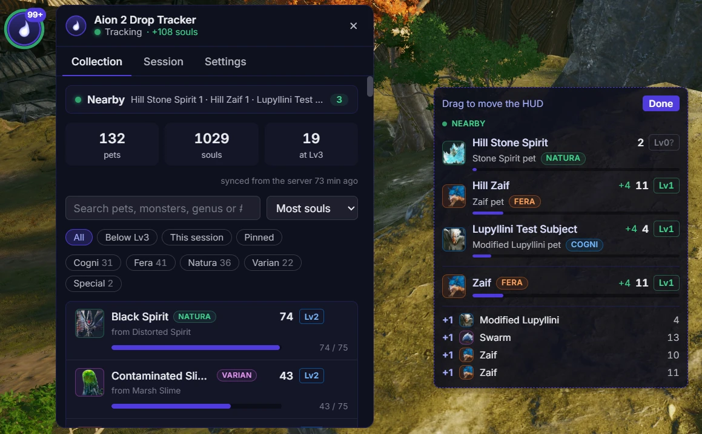

# Nyerk

A native Linux and Windows overlay that counts your Aion 2 Pet Collection souls as they drop, so you don't have
to keep opening the Pets menu.

- **Live counts:** every soul is counted the moment it drops, with level-ups (5 → 25 → 75) and the
  genus crystals that maxed (Lv3) pets give instead.
- **Login sync:** when you enter the world, your whole collection is taken from the game, so the
  counts always match the Pets menu.
- **In-game HUD:** a small click-through overlay with nearby soul monsters, this fight's pets and
  a feed of drops. It clears itself between fights.
- **Collection panel:** every pet with its genus, level and progress; search, filter, pin pets to
  the HUD, and see where each soul drops on a map.
- **Kina per hour:** this session's Kina rate with a timeline, in the panel and on the HUD.
- **Timers:** the game's events (Shugo Festival, the Black Cloud Merchant, rifts, the siege…) and
  the field bosses of Verteron, Altgard and Lower Reshanta, read from the map's field boss list,
  with optional alerts. Field boss times are shared between players so they stay right when you
  have not opened the map.
- **Black Cloud Merchant:** when you open one of its tabs, a window lists the pets it sells that
  you have not maxed, with where their soul monsters spawn.
- **One collection per character:** switching to an alt shows that character's pets.
- **Stays out of the way:** it sits in the tray and sleeps while Aion 2 is closed, waking when the
  game starts.
- And whatever else I randomly find useful while I play Aion2. :D

[Nyerk Discord](https://discord.gg/tjJkjDzbbU) - Timers and support.



## How it works

The tracker **only listens** and functions the exact same as popular DPS Meters used in Aion 2. It reads the game's network traffic passively through
libpcap on Linux or [Npcap](https://npcap.com) on Windows. It never sends anything to the game
or its servers, never reads or changes the game's memory, and sends no input.

The app talks only to **nyerk.app**: to check for updates, and (unless you switch off "Share
field boss timers") to send the field boss times your map shows and get other players' back. That
carries your game server's id and an anonymous hash of your PC, never your character's name or
position.

## Install

### Linux

Nyerk runs directly on Linux. You only need Wine/Proton for the game. These steps assume you
already have Aion 2 working; Nyerk does not set up the game or its anti-cheat.

**1. Install the basics.** You need [Python 3.12+](https://www.python.org) and
[Node.js 24](https://nodejs.org). On Ubuntu or Debian, also run:

```bash
sudo apt update
sudo apt install python3-venv libpcap0.8 libcap2-bin
```

**2. Build Nyerk.** Open a terminal in the project folder (the one containing this README), then
copy and paste these commands:

```bash
python3 -m venv .venv
.venv/bin/python -m pip install -e . pyinstaller
(cd app && npm ci && npm run pack)
```

**3. Allow Nyerk's tracker to read game traffic.** Run this once, in the same terminal. It installs
a small background helper; the Nyerk app itself will still run as your normal user. `sudo` may ask
for your Linux password.

```bash
sudo install -d -m 755 /opt/nyerk-tracker
sudo cp -a build/sidecar/aion2-tracker/. /opt/nyerk-tracker/
sudo chown -R root:root /opt/nyerk-tracker
sudo chmod -R a+rX,go-w /opt/nyerk-tracker
sudo setcap cap_net_raw=ep /opt/nyerk-tracker/aion2-tracker
```

**4. Start Nyerk**, from the project folder:

```bash
A2T_SIDECAR=/opt/nyerk-tracker/aion2-tracker ./app/dist/linux-unpacked/Aion2DropTracker
```

Use that command each time you start Nyerk, **before logging into your character**. Set the game
to borderless or windowed mode so the overlay can appear. The collection panel opens on launch;
closing it minimizes it to the taskbar. Use **Settings → Quit** to exit completely.

Repeat steps 2 and 3 when updating Nyerk. **Do not start Nyerk with `sudo`.**

<details>
<summary>Troubleshooting and other Linux setups</summary>

- **Fedora or Arch:** install `libpcap` and the package providing `setcap` (`libcap` on both),
  instead of the Ubuntu/Debian packages above.
- **Electron download:** packaging downloads Electron automatically. If an older checkout reports
  that `node_modules/electron/dist` is missing, run `npx --no-install install-electron` from `app/`,
  then try `npm run pack` again. This installs the project's Electron version; the system Electron
  package is not needed.
- **Tracking works, but windows stay invisible:** if the terminal reports Mesa/GBM driver errors
  or `XGetWindowAttributes failed for window`, quit Nyerk from the tray first, then try this from
  the project folder:

  ```bash
  A2T_SIDECAR=/opt/nyerk-tracker/aion2-tracker \
    ./app/dist/linux-unpacked/Aion2DropTracker --ozone-platform=x11 --disable-gpu
  ```

  The X11 flag selects the display backend before Electron starts; software rendering avoids the
  failing graphics driver. New builds select X11 automatically, including on Wayland desktops
  through XWayland. Keep `--disable-gpu` in your launch command if software rendering helps;
  `NYERK_SOFTWARE_RENDERING=1` is an alternative. Chromium's sandbox stays enabled. Startup,
  window-loading, and graphics errors
  are recorded in `~/.config/Nyerk/logs/tracker.log` (under `$XDG_CONFIG_HOME` if set); include those
  lines when reporting a display problem. Do not change system-driver permissions or run Nyerk
  with `sudo` to fix a graphics error.
- **Overlay missing:** Nyerk needs X11 or XWayland. On a Wayland desktop, install XWayland;
  alternatively, log out and select an X11/Xorg session on the login screen. Some desktop
  compositors may still restrict overlays. Native Wayland overlay placement is not supported.
- **Capture permission error with a VPN:** some tunnel adapters need an extra permission. Run
  `sudo setcap cap_net_raw,cap_net_admin=ep /opt/nyerk-tracker/aion2-tracker`, then restart Nyerk.
  Capture can only see network interfaces available to the helper; separately sandboxed games
  may need host-network access.
- **AppImage:** build one with `npm run dist:linux` from `app/`. Make the resulting file executable
  and launch it with `A2T_SIDECAR=/opt/nyerk-tracker/aion2-tracker` as above. Keep the separate
  helper: permissions cannot be saved inside the AppImage's temporary, read-only mount. FUSE may
  be required to run the AppImage.
- **Other limitations:** Linux updates are manual, and hiding overlays from screen recordings is
  unavailable. Only enable trusted Python addons: they share the helper's capture permissions.
  Saved settings and collections normally live in `~/.config/Nyerk/` (`$XDG_CONFIG_HOME/Nyerk/`
  if you changed that location). Browsing collections and replaying saved captures need no special
  permissions.

</details>

### Windows

1. Install [Npcap](https://npcap.com) (the default options are fine).
2. Download `Nyerk-Setup-<version>.exe` from the
   [latest release](../../releases/latest) and run it. It installs for your Windows account only.
   The installer is not code-signed, so Windows may show "Windows protected your PC": choose
   **More info → Run anyway**.
3. Start the tracker **before you log in** to your character, so it picks up your collection.

The overlay draws over **borderless or windowed** mode, not exclusive fullscreen. The app checks
for updates by itself and asks before installing one.

## Build from source

Needs [Python 3.12+](https://www.python.org), [Node.js 24](https://nodejs.org), and the platform's
capture library. Linux also needs the usual Electron desktop libraries (GTK 3, NSS, ALSA and X11).
Build on the target operating system: PyInstaller cannot cross-compile the tracker helper.
For release artifacts, build on the oldest Linux distribution and target architecture you intend
to support: the frozen Python helper inherits the build host's glibc requirements. This cloud
build uses glibc 2.41 and is not a compatibility build for older distributions.

On Linux:

```bash
python3 -m venv .venv
.venv/bin/python -m pip install -e . pytest pyinstaller
cd app
npm ci
npm run check
npm run build
npm run dev
```

Development automatically uses `.venv/bin/python`; `A2T_PYTHON` or the Python setting can override
it. For live capture use the capability-enabled helper via `A2T_SIDECAR`, as above. With the game
closed, the backend stays paused and the panel remains usable without capture privileges.

For a distributable build, run `npm run pack` or `npm run dist:linux` from `app/`. Both build the
native sidecar and generate the app icon. Windows builds use `npm run dist:win` on Windows.

On Windows:

```bash
python -m venv .venv
```

```bash
.venv\Scripts\python -m pip install -e . pyinstaller
```

```bash
cd app && npm ci && npm run dist:win
```

The installer is written to `app/dist/`. To run without installing, use `npm run build` and then
start Electron from `app/` (`npx electron .`).

### Validation without the game

Run `.venv/bin/python -m pytest` from the repository and `npm run check` from `app/` for capture,
process detection, desktop policy and helper cleanup tests. `npm run build` builds main, preload,
and the Vue renderer. Exercise the backend without privileges with:

```bash
.venv/bin/python -m aion2_tracker.sidecar --paused --data /tmp/nyerk-dev-collection.json
```

Expect `ready` and `idle` JSON messages. Enter `{"cmd":"snapshot"}` to request the collection,
then `{"cmd":"quit"}` to stop it. To run the UI against a saved capture, launch from `app/` with
`A2T_REPLAY=/absolute/path/to/capture.pcap npm run dev`; no game or live-capture permissions are
needed. Captures can contain personal game data. Desktop smoke tests require a display (Xvfb is
suitable for headless testing); neither those tests nor offline replay validate a real Wine/Proton
game session or its anti-cheat compatibility.

## Privacy

Nyerk itself sends data only to nyerk.app:

- **Your IP address**, which every connection carries, for the field boss timers and update checks.
- **The app's version**, which every request names.
- **A machine identifier** for the crowd-sourced field boss timers: a salted hash of your Linux
  machine-id or Windows MachineGuid, made on your PC, so the id itself never leaves it. A persistent
  random identifier is used if the system identifier is unavailable.
- **Your game server and zone ids, and the field boss times your map shows**, for the
  crowd-sourced timers.

Turn off **Share field boss timers** in the app's Timers tab to stop sending the machine identifier
and the timers; the app then uses only your own map. Update checks never carry either.

Nothing else from the game is sent: not your character's name, position or account.

Addons you install may connect to other sites; each addon lists the sites it uses.

To have your data deleted, open a [GitHub issue](../../issues) or ask in the
[Nyerk Discord](https://discord.gg/tjJkjDzbbU).

## Code signing policy

Free code signing provided by [SignPath.io](https://about.signpath.io/), certificate by
[SignPath Foundation](https://signpath.org/).

Installers are built from this repository by GitHub Actions and signed only after a maintainer
approves each signing request.

- Committers and reviewers: [xCROv](https://github.com/xCROv)
- Approvers: [xCROv](https://github.com/xCROv)

What the app sends, and to whom: see [Privacy](#privacy).

## Credits

- Monster names (`data/npcs_en.json`) come from
  [taengu/A2Tools-DPS-Meter](https://github.com/taengu/A2Tools-DPS-Meter), licensed GPL-3.0.
- Pet names, genus, portraits, spawn locations and zone maps come from
  [questlog.gg](https://questlog.gg/aion-2/en/db/pets).
- Aion 2 and its game data and art belong to NCSoft. This project is not affiliated with or
  endorsed by NCSoft or questlog.gg.

## License

[GPL-3.0](LICENSE). It includes GPL-3.0 data from A2Tools-DPS-Meter (see Credits).

## Disclaimer

Use at your own risk. The tracker is passive, but whether third-party tools are allowed is up to
the game's Terms of Service.
